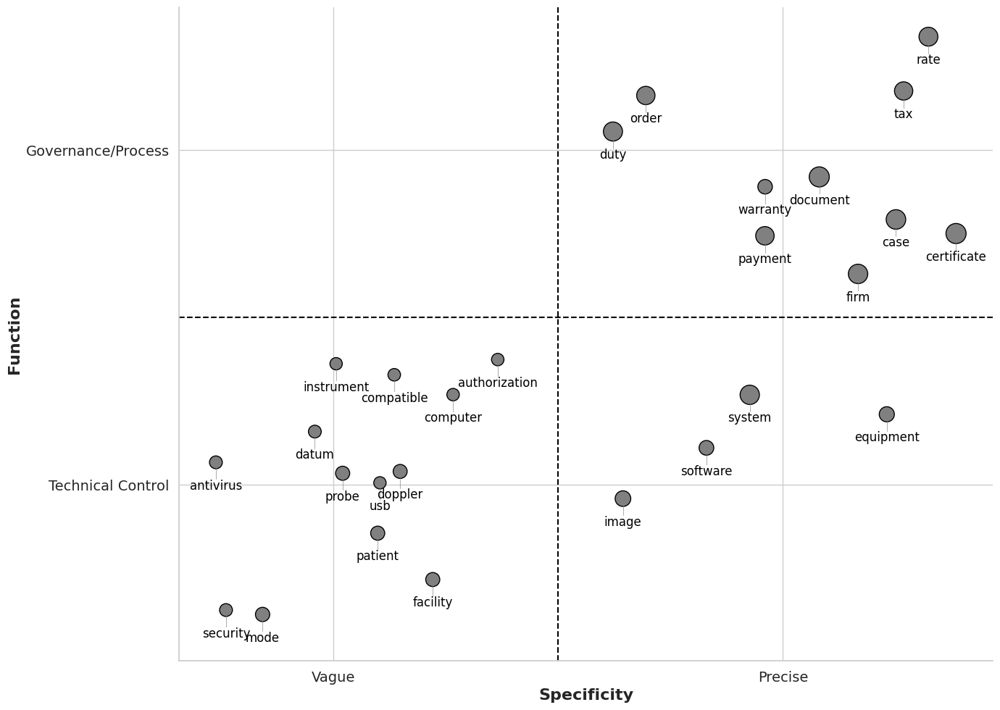
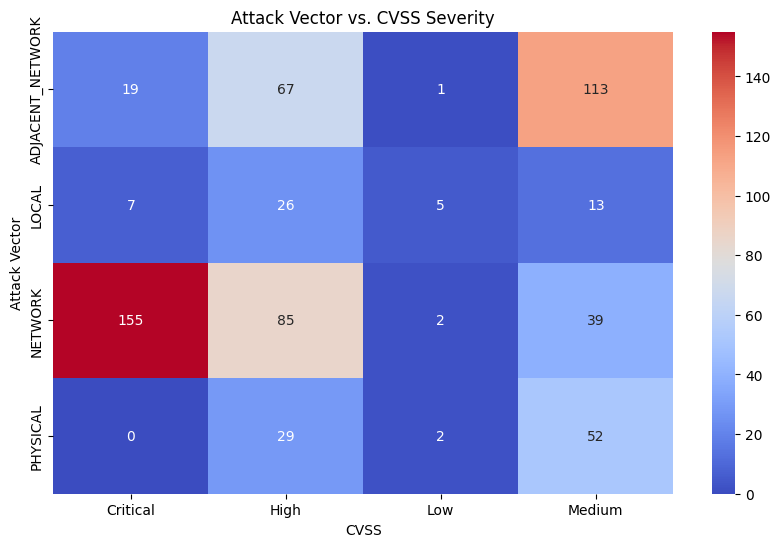
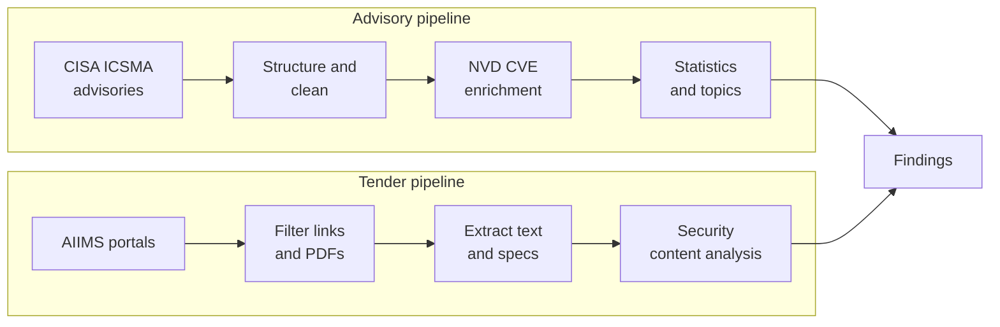
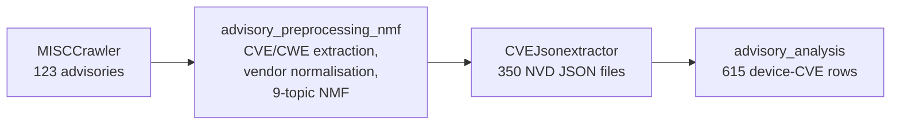
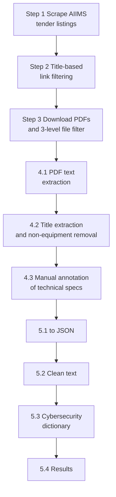

# Cybersecurity of Healthcare Devices

**Two data-driven views of medical-device cybersecurity:** what vulnerabilities are *disclosed* (CISA ICS-medical advisories) versus what security is actually *asked for* when hospitals buy devices (AIIMS procurement tenders).

| | Advisory pipeline | Tender pipeline |
|---|---|---|
| **Question** | Which devices, weaknesses and attack vectors dominate disclosed vulnerabilities? | Do hospital tenders ask for cybersecurity at all? |
| **Source** | CISA ICSMA advisories + NVD CVE records | AIIMS tender PDFs (portals across India) |
| **Method** | Web scraping, NVD enrichment, TF-IDF + NMF topics | Scraping, multi-stage filtering, manual annotation, keyword + TF-IDF/NMF analysis |

---

## Key Findings

| Finding | Value |
|---|---|
| Tenders whose technical specification contains security content | **114 of 760 (15.0%)** |
| Critical/High vulnerabilities exploitable over the **network** | **240 of 388 (61.9%)** |
| Equipment-vulnerability pairs analysed | 615 (297 unique CVEs, 84 CWEs, 171 devices) |
| Most frequent weaknesses | CWE-287 (auth), CWE-798 (hard-coded credentials), CWE-330 (weak randomness) |

<p align="center">
  
  
</p>

---

## Overview



---

## Advisory Pipeline (`Advisory/`)



| Step | Folder | Output |
|---|---|---|
| 1. Crawl | `Step_1_Crawler/Step1_crawler` | `unstructureddataset.xlsx` |
| 2. Structure | `Step_1_Crawler/Step2_structure_dataset` | `structureddataset.xlsx` (128 rows after splitting multi-vendor advisories) |
| 3. Enrich | `Step_1_Crawler/Step3_CVE_collection` | one NVD JSON per CVE in `cvedata/` |
| 4. Analyse | `Step_2_Analysis` | `Equipmentseparateddata.xlsx`, top CWEs, device ranking, attack-vector heatmap |

---

## Tender Pipeline (`Final Tender Code/Step Distribution/`)



| Step | Purpose |
|---|---|
| **1** Scraping | Selenium scrapers collect tender listings from AIIMS portals into per-institute sheets |
| **2** Link filtering | Normalise titles, drop non-equipment categories, filter by link keywords |
| **3** Collection | Download PDFs; set aside image-heavy scans and files under 4 pages; sort GeM, EOI and tender documents into separate folders |
| **4.1** Text | `pdfplumber` extraction of text and tables |
| **4.2** Titles | Regex title extraction, keyword filter removes consumables and hardware |
| **4.3** Annotation | Annotators mark the technical-specification pages of connected medical devices through a small GUI |
| **5.1-5.2** Prepare | Convert to JSON, lemmatise, remove stopwords |
| **5.3** Dictionary | cybersecurity terms scraped from a public glossary |
| **5.4** Results | Security presence, TF-IDF, specificity vs function map, NMF topics, referenced ISO/IEC standards |

**Result: 760 annotated tender documents, 15.0% with any security content.** Only 20 of 102 dictionary terms ever appear, led by *virus*, *patch*, *authorization*.

---

## Repository Layout

```
.
├── Advisory/
│   ├── Step_1_Crawler/        crawl, structure, NVD enrichment
│   └── Step_2_Analysis/       statistics and figures
├── Final Tender Code/Step Distribution/
│   ├── Step-1 ... Step-5      tender pipeline (numbered in run order)
├── *.png                      figures used in the paper
└── LLM_HANDOUT.md             full technical reference
```

## Running It

Python 3.12 with Jupyter. Main libraries: `pandas`, `requests`, `beautifulsoup4`, `selenium`, `pdfplumber`, `PyPDF2`, `PyMuPDF`, `nltk`, `spacy` (`en_core_web_md`, `en_core_web_sm`), `scikit-learn`, `gensim`, `seaborn`, `matplotlib`.
Run notebooks in step order. Notebooks read the previous step's output with relative paths. Some intermediate JSON files (`output_data.json`, `cleaned_files.json`, etc.) are git-ignored and must be regenerated.
